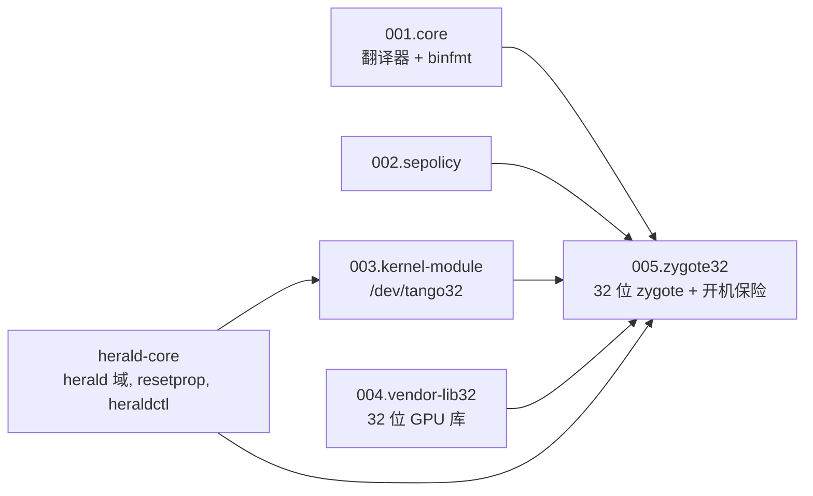

# tb321fu-tango-patch — 设计

## 多语言

**简体中文** | [English](en/DESIGN.md) | [Español](es/DESIGN.md)

## 文档

- 项目概览: [README](../README.md)

- 设计思路: [DESIGN](DESIGN.md)

- 项目状态: [LOG](LOG.md)
- 历史记录: [HISTORY](HISTORY.md)
- 变更日志: [CHANGELOG](CHANGELOG.md)

- 第三方声明: [THIRD_PARTY_NOTICES](THIRD_PARTY_NOTICES.md)

## 设计目标

- [x] TB321FU 刷 GSI 后免 root 安装和运行 32 位 APK.
- [x] 不修改 framework 和原厂 vendor 分区, 所有改动都在 system 镜像内.
- [x] Tango 出问题时系统仍能开机, 只影响 32 位 app.
- [x] 构建时发现输入或底包不匹配就停止, 不产出开不了机的镜像.
- [x] 仓库和分发的刷机包不含 Tango 和小米的专有文件.
- [ ] 按需启动 32 位 zygote (需要修改 framework).
- [ ] 预翻译 32 位库 (需要修改 framework 和 installd 源码).
- 非目标: 支持 TB321FU 以外的设备, 或脱离 TB321FU-GSI-Mods 单独构建. 其他设备的移植方法由 [tango-porting-guide](https://github.com/CharlesGool/tango-porting-guide) 说明.

## 架构

本项目是 [TB321FU-GSI-Mods](https://github.com/CharlesGool/TB321FU-GSI-Mods) 的一个补丁. Mods 的构建系统读取 `patch/patch.conf`, 执行 `patch/apply.sh`; `apply.sh` 先确认 herald-core 已打, 再用 Mods 的 `run_parts` 按编号执行 5 个部分的 `part.sh`. `part.sh` 使用 Mods 提供的函数 (`put`, `put_dir`, `prop`, `append`, `need_input`, `need_file`, `die` 等) 改写 system 树.

4 个基础部分之间没有构建依赖, 单独打入都不影响开机; `005.zygote32` 声明 32 位 ABI, 功能上需要前 4 个部分. 各部分的原理和开机顺序见 [patch/README.md](../patch/README.md).

| 顶层目录 | 职责 |
| --- | --- |
| `patch/` | 补丁本体, 同步到 Mods 的 `patches/required/general/tango/`. `patch.conf` 是元数据, `apply.sh` 是入口, `parts/NNN.<部分>/` 下是各部分的脚本, rc, 策略和说明 |
| `doc/` | 项目文档. 调研记录和通用移植教程在 [tango-porting-guide](https://github.com/CharlesGool/tango-porting-guide) |
| `third_party/` | 第三方许可证原文, 每个来源一个子目录 |

本项目没有界面文本, 也没有构建输出; 构建输出在 Mods 的 `out/`.

## 设计约束

- `tango_translator`, Tango 集成包, `tango32.ko` 和小米的 32 位库**禁止**进仓库. `.gitignore` 忽略 `private/`.
- **禁止**修改 `ro.zygote`. 32 位 zygote 服务名**禁止**用 `zygote_secondary`, socket 名**必须**是 `zygote_secondary`.
- 32 位 zygote 服务**禁止**带 `onrestart restart zygote`.
- `tango32.ko` 的 `vermagic` **必须**等于 `TANGO_KERNEL_RELEASE`; 32 位库**必须**与 `manifest.sha256` 一致. 不一致时构建停止.
- 声明 32 位 ABI 后会触发的原厂 vendor 服务, 带 `reboot_on_failure` 或 `critical` 的**必须**被接管, 否则构建停止.
- 开机保险**必须**在 `zygote-start` 之前 (`post-fs-data` 的 `exec_start`) 关闭 WALT 32 位自检并置 `tango.zygote32`.
- `patch/` 的修改**必须**先在本仓库提交, 再同步到 Mods.

## 数据设计

设备上的运行数据, 不在仓库中:

| 位置 | 内容 |
| --- | --- |
| `/metadata/tango_log/` | `guard.txt`, `guard.prev.txt`, `insmod.txt`, `insmod.prev.txt`, `diag.txt`, 翻译器日志, `pstore_<时间>/`, 标记文件 `booting`, `fallback`, `guard_enforce`. 放在 `/metadata` 是因为它在 first-stage 挂载, 开机循环时也保留 |
| `/data/local/tmp/tango_log/` | 上一项的 shell 可读副本, 由 `tango-export.sh` 生成 |
| 系统属性 | `tango.enabled`, `tango.debug`, `tango.log_dir`, `tango.zygote32`, `tango.fallback`, `persist.tango.guard_enforce` |

## 外部接口

| 接口 | 提供方 | 用途 |
| --- | --- | --- |
| 补丁格式 (`patch.conf`, `apply.sh`, `run_parts`) 和构建函数 | TB321FU-GSI-Mods | 把文件, 属性和策略写进 system 镜像 |
| 构建输入变量 | Mods 的 `devices/<设备>/conf.d/tango.conf`, `device.conf` | 定位私有输入和原厂 vendor 镜像 |
| herald 域, `resetprop`, broker 和 heraldctl 插件目录 | [herald-core](https://github.com/CharlesGool/herald-core) | 以 root 加载模块, 运行开机保险, 提供 `heraldctl tango` 命令 |
| `binfmt_misc`, `/dev/tango32`, `/proc/sys/walt/panic_on_walt_bug` | 设备内核和联想 `sched-walt.ko` | 翻译, compat 系统调用, 关闭 WALT 32 位自检 |
