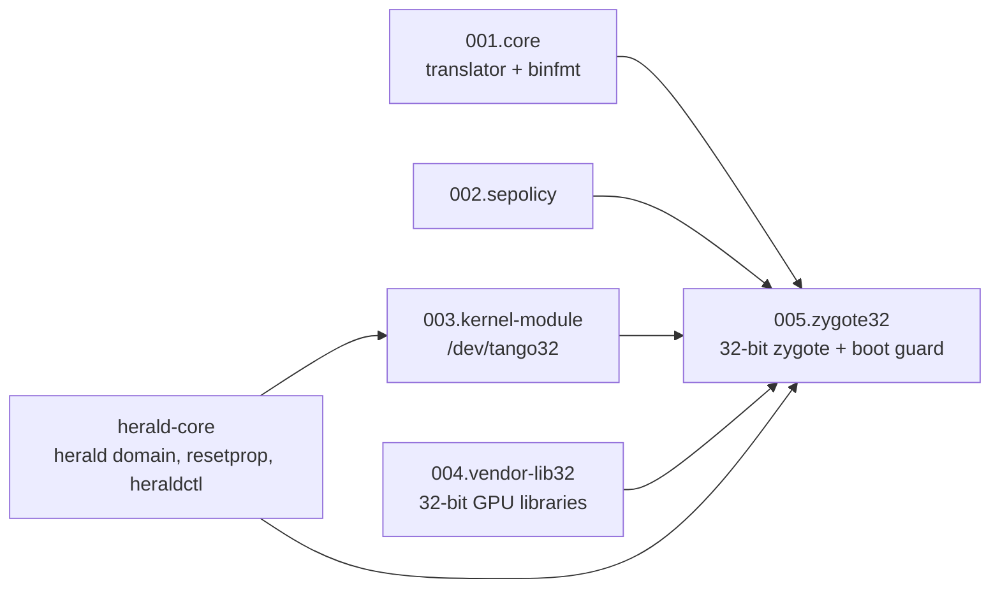

# tb321fu-tango-patch — Design

## Multi-language

[简体中文](../DESIGN.md) | **English** | [Español](../es/DESIGN.md)

## Documentation

- Project overview: [README](README.md)

- Design rationale: [DESIGN](DESIGN.md)

- Project status: [LOG](LOG.md)
- Historical records: [HISTORY](HISTORY.md)
- Version changelog: [CHANGELOG](CHANGELOG.md)

- Third-party notices: [THIRD_PARTY_NOTICES](THIRD_PARTY_NOTICES.md)

## Design Goals

- [x] Install and run 32-bit APKs on a TB321FU with a GSI, without root.
- [x] Do not modify the framework or the stock vendor partition; all changes are inside the system image.
- [x] The system still boots when Tango fails; only 32-bit apps are affected.
- [x] Stop the build when inputs or the base image do not match, so no unbootable image is produced.
- [x] The repository and distributed flashing packages contain no proprietary files from Tango or Xiaomi.
- [ ] Start the 32-bit zygote on demand (needs framework changes).
- [ ] Pre-translate 32-bit libraries (needs changes to the framework and installd source).
- Non-goals: supporting devices other than TB321FU, or building without TB321FU-GSI-Mods. The porting method for other devices is described by [tango-porting-guide](https://github.com/CharlesGool/tango-porting-guide).

## Architecture

This project is a patch for [TB321FU-GSI-Mods](https://github.com/CharlesGool/TB321FU-GSI-Mods). The Mods build system reads `patch/patch.conf` and runs `patch/apply.sh`; `apply.sh` first confirms that herald-core has been applied, then uses the Mods `run_parts` to run the `part.sh` of the 5 parts in numbered order. `part.sh` rewrites the system tree using functions provided by Mods (`put`, `put_dir`, `prop`, `append`, `need_input`, `need_file`, `die`, etc.).

The 4 base parts have no build dependencies on each other, and applying any of them alone does not affect booting; `005.zygote32` declares the 32-bit ABI and functionally needs the first 4 parts. For the principles of each part and the boot order, see [patch/README.md](../../patch/README.md).

| Top-level directory | Responsibility |
| --- | --- |
| `patch/` | The patch itself, synchronized to `patches/required/general/tango/` in Mods. `patch.conf` is the metadata, `apply.sh` is the entry point, and `parts/NNN.<part>/` holds each part's scripts, rc files, policy and description |
| `doc/` | Project documentation. The research notes and the general porting tutorial are in [tango-porting-guide](https://github.com/CharlesGool/tango-porting-guide) |
| `third_party/` | Original third-party license texts, one subdirectory per source |

This project has no UI text and no build output; build output goes to `out/` in Mods.

## Design Constraints

- `tango_translator`, the Tango integration package, `tango32.ko` and Xiaomi's 32-bit libraries **MUST NOT** enter the repository. `.gitignore` ignores `private/`.
- **MUST NOT** modify `ro.zygote`. The 32-bit zygote service name **MUST NOT** be `zygote_secondary`, and the socket name **MUST** be `zygote_secondary`.
- The 32-bit zygote service **MUST NOT** carry `onrestart restart zygote`.
- The `vermagic` of `tango32.ko` **MUST** equal `TANGO_KERNEL_RELEASE`; the 32-bit libraries **MUST** match `manifest.sha256`. The build stops on a mismatch.
- Stock vendor services that are triggered after the 32-bit ABI is declared and carry `reboot_on_failure` or `critical` **MUST** be taken over; otherwise the build stops.
- The boot guard **MUST** disable the WALT 32-bit self-check and set `tango.zygote32` before `zygote-start` (via `exec_start` in `post-fs-data`).
- Changes to `patch/` **MUST** be committed in this repository first, then synchronized to Mods.

## Data Design

Runtime data on the device, not in the repository:

| Location | Content |
| --- | --- |
| `/metadata/tango_log/` | `guard.txt`, `guard.prev.txt`, `insmod.txt`, `insmod.prev.txt`, `diag.txt`, translator logs, `pstore_<time>/`, marker files `booting`, `fallback`, `guard_enforce`. Placed in `/metadata` because it is mounted in first-stage and survives boot loops |
| `/data/local/tmp/tango_log/` | A shell-readable copy of the item above, generated by `tango-export.sh` |
| System properties | `tango.enabled`, `tango.debug`, `tango.log_dir`, `tango.zygote32`, `tango.fallback`, `persist.tango.guard_enforce` |

## External Interfaces

| Interface | Provider | Purpose |
| --- | --- | --- |
| Patch format (`patch.conf`, `apply.sh`, `run_parts`) and build functions | TB321FU-GSI-Mods | Write files, properties and policy into the system image |
| Build input variables | `devices/<device>/conf.d/tango.conf` and `device.conf` in Mods | Locate the private inputs and the stock vendor image |
| herald domain, `resetprop`, broker and heraldctl plugin directory | [herald-core](https://github.com/CharlesGool/herald-core) | Load the module as root, run the boot guard, provide the `heraldctl tango` command |
| `binfmt_misc`, `/dev/tango32`, `/proc/sys/walt/panic_on_walt_bug` | Device kernel and Lenovo `sched-walt.ko` | Translation, compat system calls, disabling the WALT 32-bit self-check |
