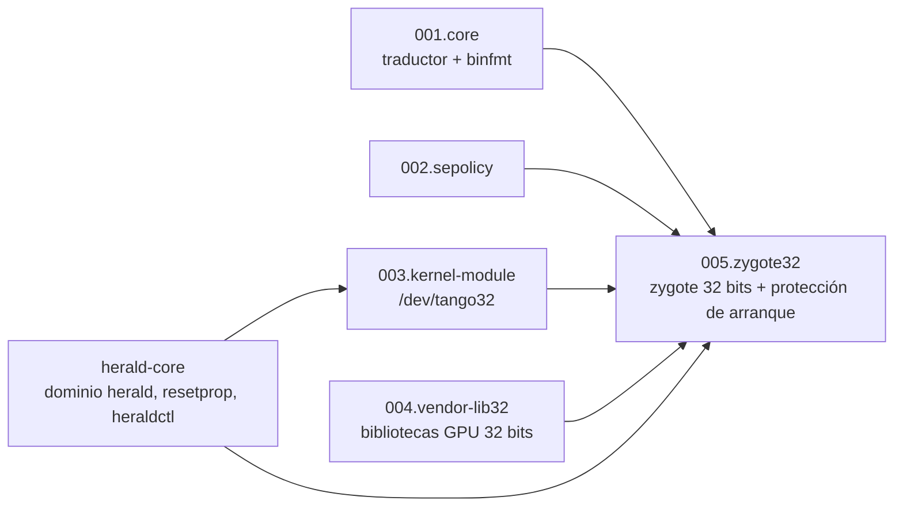

# tb321fu-tango-patch — Diseño

## Multilingüe

[简体中文](../DESIGN.md) | [English](../en/DESIGN.md) | **Español**

## Documentación

- Descripción general del proyecto: [README](README.md)

- Justificación del diseño: [DESIGN](DESIGN.md)

- Estado del proyecto: [LOG](LOG.md)
- Registros históricos: [HISTORY](HISTORY.md)
- Historial de cambios: [CHANGELOG](CHANGELOG.md)

- Avisos de terceros: [THIRD_PARTY_NOTICES](THIRD_PARTY_NOTICES.md)

## Objetivos de diseño

- [x] Instalar y ejecutar APK de 32 bits en la TB321FU con GSI sin root.
- [x] No modificar el framework ni la partición vendor original; todos los cambios quedan dentro de la imagen system.
- [x] Si Tango falla, el sistema sigue arrancando y solo se ven afectadas las apps de 32 bits.
- [x] Detener la construcción si las entradas o la imagen base no coinciden, en lugar de producir una imagen que no arranca.
- [x] El repositorio y el paquete de flasheo distribuido no contienen archivos propietarios de Tango ni de Xiaomi.
- [ ] Iniciar el zygote de 32 bits bajo demanda (requiere modificar el framework).
- [ ] Pretraducir las bibliotecas de 32 bits (requiere modificar el framework y el código fuente de installd).
- No objetivo: dar soporte a dispositivos distintos de la TB321FU, o construir sin TB321FU-GSI-Mods. El método de portado a otros dispositivos se describe en [tango-porting-guide](https://github.com/CharlesGool/tango-porting-guide).

## Arquitectura

Este proyecto es un parche de [TB321FU-GSI-Mods](https://github.com/CharlesGool/TB321FU-GSI-Mods). El sistema de construcción de Mods lee `patch/patch.conf` y ejecuta `patch/apply.sh`; `apply.sh` primero comprueba que herald-core ya está aplicado y luego, con `run_parts` de Mods, ejecuta por número el `part.sh` de cada una de las 5 partes. `part.sh` reescribe el árbol system con las funciones que ofrece Mods (`put`, `put_dir`, `prop`, `append`, `need_input`, `need_file`, `die`, etc.).

Las 4 partes básicas no tienen dependencias de construcción entre sí, y aplicar cualquiera de ellas por separado no afecta al arranque; `005.zygote32` declara el ABI de 32 bits y, funcionalmente, necesita las 4 primeras. El principio de cada parte y el orden de arranque están en [patch/README.md](../../patch/README.md).

| Directorio de nivel superior | Responsabilidad |
| --- | --- |
| `patch/` | El parche en sí, sincronizado con `patches/required/general/tango/` de Mods. `patch.conf` son los metadatos, `apply.sh` es el punto de entrada, y en `parts/NNN.<parte>/` están los scripts, rc, políticas y descripciones de cada parte |
| `doc/` | Documentación del proyecto. Las notas de investigación y el tutorial general de portado están en [tango-porting-guide](https://github.com/CharlesGool/tango-porting-guide) |
| `third_party/` | Textos originales de licencias de terceros, un subdirectorio por origen |

Este proyecto no tiene textos de interfaz ni salida de construcción; la salida de construcción está en `out/` de Mods.

## Restricciones de diseño

- `tango_translator`, el paquete de integración Tango, `tango32.ko` y las bibliotecas de 32 bits de Xiaomi **MUST NOT** entrar en el repositorio. `.gitignore` ignora `private/`.
- **MUST NOT** modificar `ro.zygote`. El nombre del servicio del zygote de 32 bits **MUST NOT** ser `zygote_secondary`, y el nombre del socket **MUST** ser `zygote_secondary`.
- El servicio del zygote de 32 bits **MUST NOT** llevar `onrestart restart zygote`.
- El `vermagic` de `tango32.ko` **MUST** ser igual a `TANGO_KERNEL_RELEASE`; las bibliotecas de 32 bits **MUST** coincidir con `manifest.sha256`. Si no coinciden, la construcción se detiene.
- Los servicios del vendor original que se activan al declarar el ABI de 32 bits y llevan `reboot_on_failure` o `critical` **MUST** ser asumidos por el parche; de lo contrario la construcción se detiene.
- La protección de arranque **MUST** desactivar la autocomprobación de 32 bits de WALT y establecer `tango.zygote32` antes de `zygote-start` (en el `exec_start` de `post-fs-data`).
- Los cambios en `patch/` **MUST** confirmarse primero en este repositorio y luego sincronizarse con Mods.

## Diseño de datos

Datos de ejecución en el dispositivo, que no están en el repositorio:

| Ubicación | Contenido |
| --- | --- |
| `/metadata/tango_log/` | `guard.txt`, `guard.prev.txt`, `insmod.txt`, `insmod.prev.txt`, `diag.txt`, registros del traductor, `pstore_<hora>/`, archivos marcadores `booting`, `fallback`, `guard_enforce`. Está en `/metadata` porque se monta en first-stage y se conserva incluso en un bucle de arranque |
| `/data/local/tmp/tango_log/` | Copia legible desde shell de lo anterior, generada por `tango-export.sh` |
| Propiedades del sistema | `tango.enabled`, `tango.debug`, `tango.log_dir`, `tango.zygote32`, `tango.fallback`, `persist.tango.guard_enforce` |

## Interfaces externas

| Interfaz | Proveedor | Finalidad |
| --- | --- | --- |
| Formato de parche (`patch.conf`, `apply.sh`, `run_parts`) y funciones de construcción | TB321FU-GSI-Mods | Escribir archivos, propiedades y políticas en la imagen system |
| Variables de entrada de construcción | `devices/<dispositivo>/conf.d/tango.conf` y `device.conf` de Mods | Localizar las entradas privadas y la imagen vendor original |
| Dominio herald, `resetprop`, broker y directorio de complementos de heraldctl | [herald-core](https://github.com/CharlesGool/herald-core) | Cargar módulos como root, ejecutar la protección de arranque y ofrecer el comando `heraldctl tango` |
| `binfmt_misc`, `/dev/tango32`, `/proc/sys/walt/panic_on_walt_bug` | Kernel del dispositivo y `sched-walt.ko` de Lenovo | Traducción, llamadas al sistema compat, desactivar la autocomprobación de 32 bits de WALT |
